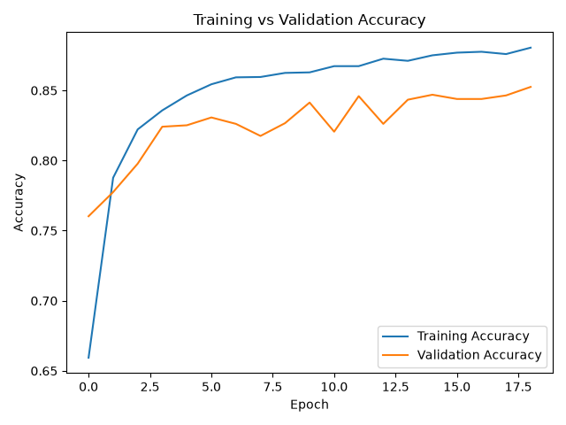
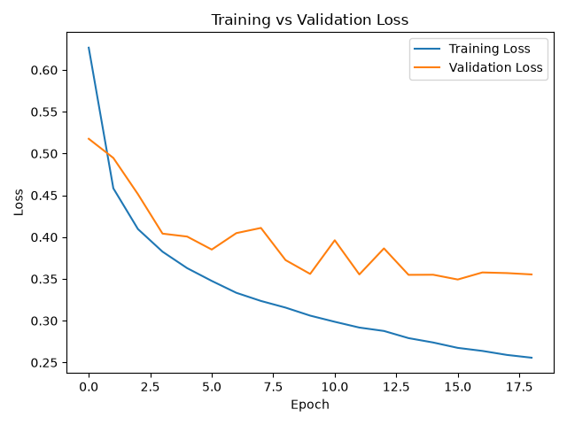

# Online Shopper Purchase Prediction

A neural network project that predicts whether an online shopping session will result in a purchase.

## Dataset

The dataset contains 12,330 online shopping sessions with 17 input features and one target variable called `Revenue`.

The target has two classes:

- `False` - No Purchase
- `True` - Purchase

The dataset is imbalanced, with significantly fewer purchasing sessions than non-purchasing sessions.

## Preprocessing

The preprocessing steps include:

- Converting the `Revenue` target to binary values
- One-hot encoding categorical features
- Splitting the data into training and testing sets
- Stratified sampling to preserve the class distribution
- Standardizing numerical features using `StandardScaler`

After one-hot encoding, the model uses 68 input features.

## Neural Network

The neural network architecture is:

- Input: 68 features
- Dense layer: 32 neurons with ReLU
- Dense layer: 16 neurons with ReLU
- Output layer: 1 neuron with linear activation

The model uses:

- Adam optimizer
- Binary Crossentropy with `from_logits=True`
- Maximum of 30 epochs
- Early Stopping
- Class weights to handle the imbalanced dataset

## Results

The final model achieved approximately:

- Test Accuracy: 84.5%
- Purchase Precision: 0.50
- Purchase Recall: 0.76
- Purchase F1-score: 0.60

Example confusion matrix:

```text
[[1796  288]
 [  93  289]]
```

The use of class weights increased the model's ability to detect purchasing sessions. Early stopping was used to reduce overfitting.

## Training Curves

### Accuracy



### Loss



## What I Learned

This project helped me practice:

- Binary classification with neural networks
- TensorFlow and Keras
- One-hot encoding
- Feature scaling
- Imbalanced datasets
- Class weights
- Precision, Recall and F1-score
- Confusion matrices
- Early stopping
- Overfitting and validation performance